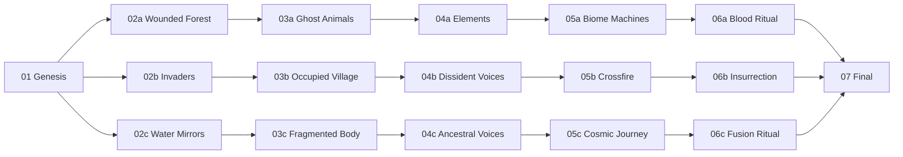
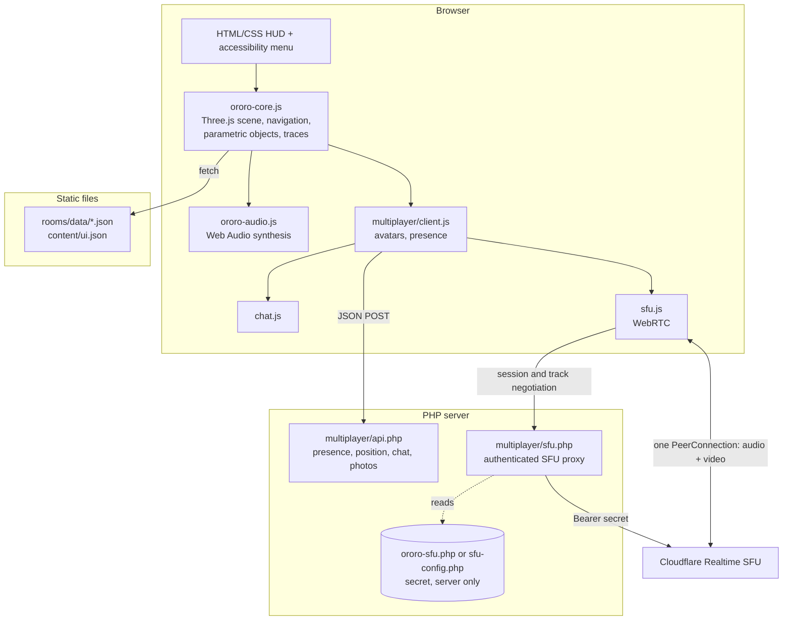

# OROЯO: an open, accessible, multi-user 3D gallery engine for the web

OROЯO is free software (GPL-3.0) for publishing navigable 3D exhibition spaces in the browser. Visitors share the space as avatars, talk by voice, show their webcam and chat. Each room has its own generated soundscape, texts in five languages and accessibility options. Everything runs from static files, JSON and a small PHP backend.

The first case study built with the engine is *OROЯO*, an artwork by Ricardo Palmieri and Natasha Marzliak: a non-linear digital gallery with 17 rooms around an entity born from oil, gold, mirrors and contamination.


-orange)


---

## Table of contents

1. [Summary](#1-summary)
2. [Social context](#2-social-context)
3. [Concept: platform and case study](#3-concept-platform-and-case-study)
4. [How a visit works](#4-how-a-visit-works)
5. [Technical architecture](#5-technical-architecture)
6. [Real-time communication](#6-real-time-communication)
7. [Accessibility](#7-accessibility)
8. [Privacy and security](#8-privacy-and-security)
9. [Installation and deployment](#9-installation-and-deployment)
10. [Cloudflare Realtime setup, step by step](#10-cloudflare-realtime-setup-step-by-step)
11. [Authoring rooms and content](#11-authoring-rooms-and-content)
12. [Repository structure](#12-repository-structure)
13. [Current status and proposed work](#13-current-status-and-proposed-work)
14. [Roadmap](#14-roadmap)
15. [Related work](#15-related-work)
16. [Team, credits and licences](#16-team-credits-and-licences)

---

## 1. Summary

Shared 3D spaces on the web (virtual galleries, social VR rooms) are mostly offered by commercial platforms. They ask for accounts, collect usage data, need recent hardware and keep the content in their own formats. Accessibility is rarely part of the design. For independent artists, small collectives and communities on the periphery of cities, this means paying for a service they do not control, or staying out.

OROЯO is a self-hostable engine for this kind of space. Each room is one JSON file that describes its atmosphere, lights, objects, texts and the choices that lead to other rooms. The browser renders the room with Three.js and synthesises its sound with the Web Audio API. A small PHP service handles presence and chat, and a WebRTC SFU relays voice and video. The whole system runs on ordinary shared hosting, with no build step, no database and no user accounts.

The engine is being tested on a real artistic production, the *OROЯO* gallery, planned as a new wing of the WebMuseu Noisetupi, a public online museum created with Lei Aldir Blanc funding in 2020 and online since 2021.

## 2. Social context

| Problem | Effect | What OROЯO does |
|---|---|---|
| Shared 3D cultural spaces depend on centralised commercial platforms | Communities lose authorship, data and continuity when a platform changes its terms or closes | GPL-3.0 code, open JSON format for content, self-hosting on low-cost shared hosting |
| Building a 3D online exhibition requires specialised skills | Mostly well-funded institutions can do it | Rooms written as JSON or in a visual editor; parametric objects replace 3D modelling; no compilation |
| Accessibility is usually missing in 3D and WebXR projects | Disabled people, neurodivergent people and people on slow connections are left out | Accessibility menu, ARIA announcements, keyboard, touch and gamepad input, microphone off by default, five languages, small downloads |
| Social platforms track their users by default | Visitors are profiled | No accounts, no analytics, the visitor's path is stored only in their own browser, server data expires |
| Artists from peripheral territories have little say over how their work circulates online | Their production reaches the network through other people's channels | A working method in which local artists author rooms of the gallery and keep their credits |

## 3. Concept: platform and case study

### 3.1 The platform

A generic engine for multi-user, accessible 3D exhibition rooms described by data:

- **Rooms as data.** One JSON file holds everything specific to a room.
- **Parametric objects.** About 40 builders for vitrines, totems, cables, roots, mirror shards, tanks, masks, animals and particle systems. Rooms can be assembled without modelling software or heavy model files.
- **Generated sound.** Each room declares a sound profile and the audio is synthesised live in the browser. There are no audio files.
- **Narrative graph.** Rooms are connected by the choices visitors make, so the path through the gallery can branch.
- **Traces.** Each choice is remembered in the visitor's browser and changes the colour of the rooms that follow.
- **Presence.** Visitors see each other as avatars, speak by voice, can show their webcam, chat in private and send files.

### 3.2 The case study: *OROЯO*

OROЯO is an entity with no original body and no fixed identity. She reorganises herself from the territories, forms of life, conflicts, memories, materials and technologies she meets. In the gallery her visible form is a mermaid-jaguar made of heavy water, oil, gold and mirror, appearing and dissolving across the rooms. The name joins *ororo* (oil, in Yoruba) and *oro* (gold, in Spanish). The palindrome with a mirrored Cyrillic Я stands for reflection and contamination.

The gallery is a work of Game Art and expanded cinema. There is no combat, score, victory or mandatory progression. Playing means walking, listening, waiting, getting closer, activating objects and making decisions that change what is seen and heard. Each path produces a different montage.

The working method is territorial: *OROЯO does not visit the territories, she is transformed by them.* The current proposal (submitted to the PNAB Santo André call, results pending) plans residencies in two areas of Santo André, São Paulo: Vila Suíça, with the Sarau na Quebrada cultural point, and Paranapiacaba, a railway heritage village in the Atlantic Forest, with Coletivo FOPP. Six local artists, three per territory, would author new territory-rooms of the gallery. The results would return to each community through public events called Decolonial Banquets and stay online free of charge.

### 3.3 Narrative structure

17 rooms in 7 stages. Stages 1 and 7 are shared. Stages 2 to 6 branch into three paths (a, b and c). In every room the central relic offers verbs. The chosen verb is stored as a trace (oil, blood, root, gold, mirror, voice, ash), tints the following rooms and returns as fragments orbiting the final core.



This is a simplified view. Choices can also cross between paths, since the graph is defined by the `next` field of each choice in the room files.

## 4. How a visit works

1. **Portal** (`index.html`). The visitor picks a language, turns sound on or off and enters.
2. **Room.** A first-person 3D space. Movement uses WASD or the arrow keys, looking around uses mouse or touch drag, and a gamepad also works. A minimap shows the visitor, the room's relic and the other people present.
3. **Objects.** Approaching or tapping an object opens a dialog with its text in the chosen language, with a noise layer in the sound.
4. **Choice.** The relic at the centre offers verbs. The chosen verb becomes a trace and the next room loads without reloading the whole page.
5. **Other visitors.** People in the same room appear as avatars, with a photo or live webcam on the face. Voice, private chat, voice notes and file sending are available.
6. **Accessibility menu.** Available in every room at any moment.

## 5. Technical architecture



| Layer | Technology | Notes |
|---|---|---|
| Rendering | Three.js, vendored ES modules loaded with an import map | `EffectComposer` and `UnrealBloomPass`; custom shaders for the liquid floor, colour pass, fog and glow |
| Engine | Plain JavaScript ES modules (`ororo-core.js`, about 3,500 lines) | Room loading, parametric object builders, navigation between rooms without page reload, minimap, traces, interface |
| Sound | Web Audio API (`ororo-audio.js`, `audio-config.js`) | Per-room profile: pad waveform, chords and detune, filter movement, noise colour, reverb size, event density; FFT analyser shown in the HUD |
| Content | JSON, one file per room plus `content/ui.json` | Portuguese, English, Spanish, German and Chinese |
| Authoring | `editor.html` with `ororo-editor.js`, and `build_rooms.py` | Visual editing and export of room files; a Python script regenerates room pages and the manifest |
| Presence | PHP 8.1+ (`multiplayer/api.php`) | Short-lived state in files in the system temp folder, protected with `flock`; access key checked against a SHA-256 hash, with rate limiting |
| Media | WebRTC through Cloudflare Realtime SFU, via `multiplayer/sfu.php` | The secret stays on the server |
| Hosting | Any Apache and PHP host with HTTPS | No database, no Node.js, no build step |

## 6. Real-time communication

Earlier versions connected every visitor directly to every other visitor (a peer-to-peer mesh). With *n* people that means *n·(n−1)/2* connections, and each person's upload grows with the size of the room. The current version gives each visitor a single connection to an SFU (Selective Forwarding Unit), which relays the streams:

- Each browser sends at most one audio track and, after the visitor turns it on, one webcam track at 320×240. It receives the tracks of the other people in the same room.
- Visitors enter with the microphone off. The browser sends a silent audio track from the start and swaps it for the real microphone with `RTCRtpSender.replaceTrack()`. Turning the microphone on and off never renegotiates or drops the call. The webcam works the same way after its first use.
- The browser only talks to our PHP proxy. The proxy checks the OROЯO session, calls the Cloudflare API with the secret and only allows a visitor to receive tracks from people in the same room.
- Presence, position, private chat, the event log and avatar photos run on the PHP service, separate from the SFU. If media fails, text chat keeps working. When the connection drops, a dialog offers to reconnect.
- STUN server: `stun.cloudflare.com:3478`. A TURN server can be added later for very restrictive networks.
- Current limit: 8 people per room. Selective subscription by proximity is on the roadmap.

## 7. Accessibility

Accessibility features live in the engine, so every room gets them.

**Already implemented**

- Accessibility menu in every room with reduced motion, high contrast and larger text. Preferences are kept in the browser.
- Dialogs use `aria-modal`, `aria-labelledby` and `aria-describedby`. Announcements go through `aria-live` regions. Toggle buttons expose `aria-pressed`, `aria-checked` and `aria-expanded`.
- Keyboard, mouse, touch and gamepad input.
- Interface and content in five languages, with the page `lang` attribute kept in sync.
- Global mute. Microphone off by default. Webcam only when the visitor turns it on.
- Text chat for people who cannot or do not want to use voice.
- Generated geometry and sound keep downloads small on slow connections.

**Missing so far** (see [Roadmap](#14-roadmap)): a version of each room that works with screen readers, audio description, captions for voice chat, automatic use of the system's reduced motion setting, a photosensitivity warning and a formal WCAG 2.2 audit. The PNAB proposal includes Libras, audio description, captions, screen-reader texts and two paid evaluation rounds with disabled people.

## 8. Privacy and security

The guiding rules are to collect as little as possible, have no accounts and no third-party analytics, delete server data quickly and keep secrets on the server.

**Already implemented**

- No login and no profile. Visitors choose a display name and, if they want, a photo.
- The visitor's path (traces) is stored only in the browser's `localStorage` and can be erased from the interface.
- Server data is temporary. Chat messages and voice notes expire after 30 minutes, avatar photos after 24 hours, and users are removed when they leave.
- Microphone and webcam need an explicit action from the visitor.
- Only PHP reads the Cloudflare App Secret. `.htaccess` blocks HTTP access to the config file, which can also live outside the public web folder (`ororo-sfu.php`). Real config files are excluded from git.
- The access key is compared with a SHA-256 hash in constant time, with a limit of 12 attempts per IP every 10 minutes.
- The API accepts only JSON POST requests, limits request size, rejects cross-site requests (`Sec-Fetch-Site`) and sends `Cache-Control: no-store` and `X-Content-Type-Options: nosniff`.

**Missing so far:** fonts are loaded from Google Fonts (a GDPR concern), there is no Content-Security-Policy, no moderation tools (mute, remove, report), no published privacy notice, and media depends on a commercial SFU provider. See the roadmap.

To report a vulnerability, please open a private GitHub security advisory instead of a public issue.

## 9. Installation and deployment

### Requirements

- A web server with PHP 8.1 or later and HTTPS. WebRTC and microphone access only work in a secure context.
- The PHP `curl` extension is recommended. Without it the proxy uses PHP streams.
- A free Cloudflare account for voice and webcam. This part is optional: the gallery, presence and chat work without it.

### Run locally

```bash
git clone https://github.com/ricardopalmieri/ORORO.git
```

```bash
cd ORORO
```

```bash
php -S localhost:8000
```

Then open <http://localhost:8000>. Browsers treat `localhost` as a secure context, so the microphone works. The single-visitor gallery runs on any static file server. Multi-user features need PHP.

### Deploy on shared hosting

1. Back up the current installation.
2. Upload the repository contents, including `multiplayer/.htaccess`.
3. Configure the SFU credentials, as described in [section 10](#10-cloudflare-realtime-setup-step-by-step).
4. Set your own access key. Generate the SHA-256 hash of a passphrase and put it in `ORORO_ACCESS_HASH` in `multiplayer/api.php`:
   ```bash
   php -r "echo hash('sha256', 'your-passphrase'), PHP_EOL;"
   ```
5. After each update, force a refresh in the browser (Ctrl/Cmd + Shift + R). Modules are versioned with `?v=` in their URLs.
6. Test with two devices on different networks, for example one on Wi-Fi and one on 4G/5G. Check that both appear in the room, audio works in both directions, switching the microphone does not drop the call, the webcam shows on the remote avatar and leaving removes the person for everyone.

## 10. Cloudflare Realtime setup, step by step

OROЯO uses Cloudflare Realtime SFU (earlier called Cloudflare Calls) to relay audio and video. You need two values: an **App ID** with 32 characters and an **App Secret** (API token) with 64 characters.

1. Create an account at <https://dash.cloudflare.com/sign-up>. The free plan is enough to start, and the SFU includes a free monthly traffic allowance. Check Cloudflare's pricing page for current numbers.
2. In the dashboard sidebar, open **Realtime** (called **Calls** in older dashboards), then **Serverless SFU**.
3. Click **Create** (or **Create application**), give it a name such as `ororo-production` and confirm.
4. Cloudflare shows the App ID and the App Secret. Copy the secret right away, because it may only be shown once. If you lose it, generate a new one on the application page.
5. On your server, copy the template:
   ```bash
   cp multiplayer/sfu-config.example.php multiplayer/sfu-config.php
   ```
   A safer option is to place the file one folder above the public web folder (next to `public_html`, for example) with the name `ororo-sfu.php`. `multiplayer/sfu.php` looks there first and falls back to `multiplayer/sfu-config.php`.
6. Fill in the values:
   ```php
   <?php
   return [
       'name'       => 'ororo',
       'app_id'     => '<32-character App ID>',
       'app_secret' => '<64-character App Secret>',
   ];
   ```
7. Open a room and turn on the microphone. If a value has the wrong format, the interface shows a local message (for example, that the App ID needs 32 characters) and nothing is sent to Cloudflare. If the credentials are wrong, the proxy passes on Cloudflare's error message without exposing the secret.

**Rules**

- Never put `app_secret` in JavaScript, HTML, URLs, `localStorage` or a git commit. `multiplayer/sfu-config.php` and `ororo-sfu.php` are listed in `.gitignore`.
- Use one Cloudflare application per environment (development and production).
- If a secret is ever exposed, generate a new one in the dashboard and update the file on the server.
- Self-hosted SFUs (LiveKit, mediasoup, Janus) are on the roadmap for full control over the data.

## 11. Authoring rooms and content

Each room is a single file, `rooms/data/<room-id>.json`. A shortened example from `sala-01-genese.json`:

```jsonc
{
  "id": "sala-01-genese",
  "stage": 1,
  "name": { "pt": "GÊNESE", "en": "GENESIS", "es": "GÉNESIS", "de": "GENESE", "zh": "创世" },
  "scene": {
    "accent": "#0E8C86", "fog": "#03070a", "fogDensity": 0.036,
    "floor": { "liquid": 0.78, "grid": 0.22 },
    "fireflies": { "color": "#B7F03B" }
  },
  "props": [
    {
      "type": "vitrine", "position": [-3.6, 0, -2.0], "size": [0.9, 1.3, 0.9],
      "content": { "title": { "en": "SCALE" }, "body": { "en": "..." } }
    }
  ],
  "central": {
    "type": "...", "title": { "en": "..." }, "body": { "en": "..." },
    "choices": [
      {
        "verb":   { "en": "ABSORB" },
        "detail": { "en": "the oil enters the skin" },
        "rastro": { "oleo": 2 },
        "next":   "sala-02a-floresta-ferida.html"
      }
    ]
  }
}
```

`rastro` is the weight a choice adds to a trace. `next` points to the following room and so defines the narrative graph.

**Workflow**

1. Edit a room in `editor.html` and export the JSON, or edit the file by hand.
2. Run `python3 build_rooms.py`. It regenerates the small HTML page for each room (`rooms/<room-id>.html`) and the manifest `rooms/data/rooms.json`. It can be run any number of times and never changes room content.
3. Interface strings shared by all rooms are in `content/ui.json`. Sound profiles are in `audio-config.js`.

`build_rooms_legacy.py`, `content/build_content_legacy.py` and `content/migrate_to_perroom.py` are kept as a record of the original geometry and texts and of the move to one file per room.

## 12. Repository structure

```text
ORORO/
├── index.html                 # portal: language, sound, entry
├── editor.html                # visual room editor
├── ororo-core.js              # engine: scene, navigation, objects, traces, interface, accessibility menu
├── ororo-audio.js             # generated sound (Web Audio)
├── ororo-editor.js            # editor logic
├── audio-config.js            # sound profile per room
├── style.css
├── build_rooms.py             # regenerates room pages and manifest
├── content/                   # interface strings (ui.json) and legacy content scripts
├── rooms/
│   ├── *.html                 # small loader page per room (generated)
│   └── data/*.json            # one file per room, plus the rooms.json manifest
├── multiplayer/
│   ├── api.php                # presence, position, chat, photos, access key
│   ├── sfu.php                # authenticated proxy to Cloudflare Realtime
│   ├── sfu-config.example.php # credentials template (copy to sfu-config.php, ignored by git)
│   ├── client.js              # multi-user client, avatars, reconnection
│   ├── sfu.js                 # WebRTC send and receive
│   ├── avatar.js, chat.js, i18n.js, style.css
│   └── .htaccess              # blocks HTTP access to the config file
└── assets/
    ├── js/                    # vendored Three.js and addons (MIT)
    └── audio|models|textures|video/   # empty folders for future media
```

## 13. Current status and proposed work

**What exists today: functional prototype, version 38**

- A navigable gallery with 17 rooms, parametric objects, generated sound and traces.
- One JSON file per room, a visual editor and a build script.
- Multi-user presence, text chat, voice notes, file sending and avatar photos.
- Voice and webcam through an SFU.
- Accessibility menu and an interface in five languages.

**Proposed new work.** The goal is to turn a prototype made for one artwork into a platform other people can reuse:

1. **Engine as a reusable package.** Separate the engine from the OROЯO content, so that theme, rooms and media become an exchangeable "exhibition pack". One template for all rooms and a documented JSON Schema.
2. **Accessible alternative mode.** A text and 2D version of every room, generated from the same JSON and usable with screen readers, plus audio description and captions.
3. **Real-time layer that scales and can be self-hosted.** Subscription by proximity to go beyond 8 people per room, push-based presence and an optional self-hosted SFU.
4. **Privacy and moderation tools.** Content-Security-Policy, self-hosted fonts, a privacy notice, consent dialogs, mute, remove and report, private rooms.
5. **Editing for people who do not program.** A complete visual editor so artists in the territories can build rooms on their own.

## 14. Roadmap

### Security and privacy

- [x] Remove credentials from the repository and its history, add `sfu-config.example.php` and exclude real config files from git
- [ ] Generate new credentials for any secret that existed outside the production server
- [ ] Content-Security-Policy, `Permissions-Policy`, `Referrer-Policy` and HSTS headers
- [ ] Serve fonts from our own server instead of Google Fonts
- [ ] Privacy notice (GDPR and Brazilian LGPD) and an explicit consent dialog for microphone and camera
- [ ] Moderation: mute, remove and report, a host role per room, private rooms by invitation
- [ ] Review chat sanitisation and file uploads (allowed types and sizes)
- [ ] Session tokens with expiry; CSRF review of the JSON API
- [ ] Optional end-to-end encryption for media (WebRTC Encoded Transforms, SFrame)
- [ ] Self-hosted SFU option (LiveKit or mediasoup)
- [ ] Automatic secret scanning in CI (gitleaks, for example)

### Accessibility

- [ ] WCAG 2.2 AA audit with axe-core and manual tests in NVDA, VoiceOver and TalkBack
- [ ] Text and 2D mode for each room, usable with screen readers
- [ ] Audio description of rooms and objects, written in the room JSON
- [ ] Live captions or transcripts for voice chat
- [ ] Follow the system settings `prefers-reduced-motion`, `prefers-contrast` and `prefers-color-scheme` automatically
- [ ] Photosensitivity warning and options to turn off grain, flicker and bloom
- [ ] Full keyboard use: visible focus, skip links, focus handling when moving between rooms
- [ ] Remappable controls; one-handed and switch navigation (click to move)
- [ ] Light mode for older phones and slow networks (simpler geometry, no post-processing, fewer particles)
- [ ] Sign language video layer (Libras, DGS) and languages added by the community, including Indigenous languages
- [ ] Design and test sessions with disabled people

### Scale and maintenance

- [ ] Replace polling with WebSocket or Server-Sent Events for presence
- [ ] Subscribe to tracks by proximity, to allow more than 8 people per room
- [ ] One room template instead of 17 near-identical HTML pages
- [ ] JSON Schema for rooms, checked in the editor and in CI
- [ ] Split `ororo-core.js` into modules (scene, objects, interface, navigation, accessibility)
- [ ] Publish the engine as an installable package, with OROЯO as an example exhibition pack
- [ ] Move every string, including PHP messages, into translation files, with a simple process for new languages
- [ ] Optional media files (GLB models, textures, video) with lazy loading and compression (Draco, KTX2)
- [ ] Docker image and deployment guides
- [ ] Automated tests: unit tests for object builders, end-to-end tests for navigation and multi-user
- [ ] Semantic versioning, changelog, contribution guide and code of conduct
- [ ] WebXR mode for VR headsets, added on top of the browser version

## 15. Related work

| Tool | Model | What OROЯO adds |
|---|---|---|
| Commercial virtual gallery and social VR services (Spatial, Gather, Artsteps) | Closed, account-based, centralised | Self-hosting, no accounts, open content format |
| Mozilla Hubs (now maintained by its community) | Open source, needs heavier server infrastructure | Runs on shared PHP hosting without Node, database or containers |
| A-Frame and plain Three.js | Libraries for building 3D scenes | Ready rooms, narrative graph, presence and accessibility included |
| Video calls (Jitsi, BigBlueButton) | Communication without a spatial or artistic layer | Authored spaces with communication built in |

## 16. Team, credits and licences

- **Ricardo Palmieri (Noisetupi).** Co-author and co-director of *OROЯO*; game design, programming (Three.js, Web Audio, multi-user), visual and spatial construction; creator of the WebMuseu Noisetupi. Contributor to this repository.
- **Natasha Marzliak.** Co-author and co-director of *OROЯO*; dramaturgy, conceptual research, narrative and shared curatorship.
- **Artists from Vila Suíça and Paranapiacaba** (Santo André, Brazil). Authors of future territory-rooms, credited as their rooms are created.

**Licences**

- OROЯO engine code: GNU GPL-3.0, see [LICENSE](LICENSE).
- Three.js and addons (`assets/js/`): MIT License, © three.js authors.
- IBM Plex fonts: SIL Open Font License 1.1.
- Artistic content of the *OROЯO* case study (texts, concept, characters): © the authors. A reuse licence, such as Creative Commons, is still to be defined.
