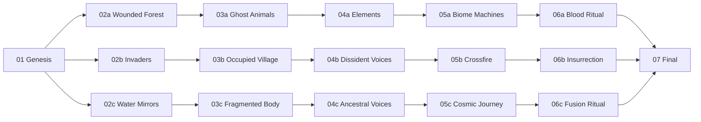
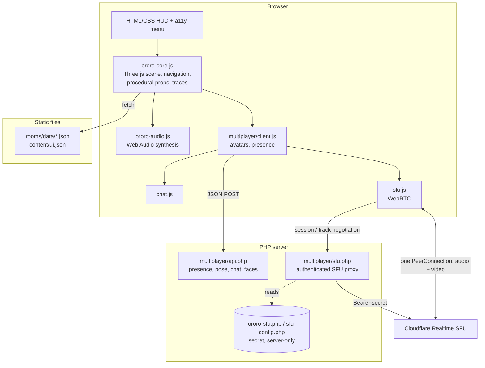

# OROЯO — an open, accessible, multi-user 3D gallery engine for the web

> **OROЯO** is a free and open-source (GPL-3.0) browser platform that lets artists, collectives and communities publish navigable, multi-user 3D exhibition spaces — with voice, video, chat, generative sound, five languages and built-in accessibility options — using only static files, JSON and a small PHP backend.
>
> *OROЯO — the artwork* (a decolonial, post-human mermaid-jaguar entity) is the platform's first **case study**: a 17-room, non-linear digital gallery built entirely with the engine.


-orange)


---

## Table of contents

1. [Summary](#1-summary)
2. [Social context and problem](#2-social-context-and-problem)
3. [Concept: platform and case study](#3-concept-platform-and-case-study)
4. [How it works — the visitor's journey](#4-how-it-works--the-visitors-journey)
5. [Technical architecture](#5-technical-architecture)
6. [Real-time communication](#6-real-time-communication)
7. [Accessibility](#7-accessibility)
8. [Privacy and security](#8-privacy-and-security)
9. [Installation and deployment](#9-installation-and-deployment)
10. [Cloudflare Realtime setup (step by step)](#10-cloudflare-realtime-setup-step-by-step)
11. [Authoring rooms and content](#11-authoring-rooms-and-content)
12. [Repository structure](#12-repository-structure)
13. [Current status and proposed work](#13-current-status-and-proposed-work)
14. [Roadmap / To-do](#14-roadmap--to-do)
15. [Related work and positioning](#15-related-work-and-positioning)
16. [Team, credits and licences](#16-team-credits-and-licences)

---

## 1. Summary

Immersive online spaces — "virtual galleries", "metaverse" rooms, social VR — are today provided almost entirely by proprietary, centralised platforms. They require accounts, collect behavioural data, demand powerful hardware, lock content into closed formats and rarely treat accessibility as a first-class requirement. Small cultural actors, peripheral communities and independent artists either cannot afford them or must surrender authorship and data to use them.

OROЯO proposes a **lightweight, self-hostable alternative**: a web engine in which each exhibition room is a single declarative JSON file (atmosphere, lights, objects, texts in five languages, narrative choices). The engine renders it in real time with Three.js, synthesises its soundscape procedurally with the Web Audio API, and connects visitors through a minimal PHP presence service plus a WebRTC Selective Forwarding Unit (SFU) for voice and webcam. It runs on commodity shared hosting, needs no build tooling and has no user accounts.

The engine is validated through a real artistic production: *OROЯO*, a 17-room digital gallery developed with territorial communities in Santo André (São Paulo, Brazil), to be integrated into the long-running public **WebMuseu Noisetupi** (online since 2020).

## 2. Social context and problem

| Problem | Consequence | How OROЯO responds |
|---|---|---|
| Immersive cultural spaces are proprietary and centralised | Communities lose authorship, data and continuity when a platform changes its terms or shuts down | GPL-3.0 code, open JSON content format, self-hosting on cheap shared hosting |
| High technical barrier to entry | Only well-funded institutions build 3D / online exhibitions | Rooms authored as JSON or in a visual editor; no compilation step; procedural assets instead of 3D modelling |
| Accessibility is an afterthought in 3D / WebXR | Disabled, neurodivergent and low-bandwidth audiences are excluded | Accessibility menu (reduced motion, high contrast, larger text), ARIA live regions, keyboard / touch / gamepad input, opt-in microphone, multilingual UI, lightweight assets |
| Surveillance by default on social platforms | Visitors are tracked and profiled | No accounts, no analytics, personal journey stored only in the visitor's browser, ephemeral server state |
| Digital exclusion of peripheral territories | Cultural production from the margins rarely reaches the network on its own terms | Methodology in which local artists are co-authors of rooms, not content suppliers |

## 3. Concept: platform and case study

### 3.1 The platform (the software)

A generic engine for **data-driven, multi-user, accessible 3D exhibition rooms**:

- **Declarative rooms** — one JSON file describes everything that makes a room unique.
- **Procedural assets** — a library of ~40 parametric 3D builders (vitrines, totems, cables, roots, mirror shards, tanks, masks, creatures, particle systems), so rooms can be built without 3D-modelling skills or heavy model files.
- **Procedural sound** — each room declares a sound profile; audio is synthesised live, with zero audio files.
- **Narrative graph** — rooms are linked by visitor choices ("verbs"), allowing non-linear dramaturgy.
- **Traces** — the visitor's path is remembered locally and fed back into the visuals.
- **Co-presence** — visitors see each other as avatars, talk by voice, share webcam, chat and exchange files.

### 3.2 The case study: *OROЯO*, the artwork

OROЯO is an entity — river, machine, mirror, animal and process — whose visible form is a **mermaid-jaguar** born from oil, gold, mirrors and contamination. She is deliberately fluid: never a fixed character, never a mascot. The gallery is a dark, contaminated territory in which the visitor does not "learn about" OROЯO but is absorbed into her process: *absorb, refuse, transmute*.

The work is created through a territorial methodology: **"OROЯO does not visit the territories. OROЯO is transformed by them."** Two creative hubs — Vila Suíça (Sarau na Quebrada) and Paranapiacaba (a historic railway village in the Atlantic Forest) — host short residencies in which local artists author rooms of the gallery. Results are returned to the communities through performative events ("Decolonial Banquets") and remain permanently and freely accessible online.

### 3.3 Narrative structure

17 rooms in 7 stages. Stages 1 and 7 are shared; stages 2–6 branch into three parallel paths (a / b / c). In each room the visitor chooses a verb at the central relic; the choice is logged as a **trace** (oil, blood, root, gold, mirror, voice, ash) that tints subsequent rooms and reappears as fragments orbiting the final core.



*(Simplified view — choices may also cross between paths. The graph is defined entirely by the `next` field of each choice in the room JSON.)*

## 4. How it works — the visitor's journey

1. **Portal** (`index.html`) — choose language, sound on/off, enter.
2. **Room** — a first-person 3D space. Move with WASD / arrow keys, look by dragging (mouse or touch), or use a gamepad. A minimap shows position, the room's relic and other visitors.
3. **Inspect** — approaching or tapping an object opens an accessible modal with its text in the selected language; a modulated noise bed accompanies it.
4. **Choose** — the central relic offers verbs. The chosen verb is stored as a trace and the visitor moves to the next room without a full page reload.
5. **Meet** — other visitors in the same room appear as avatars (with a photo or live webcam on the face). Voice chat, private text chat, voice notes and file transfer are available.
6. **Accessibility menu** — reachable from every room at any time.

## 5. Technical architecture



| Layer | Technology | Notes |
|---|---|---|
| Rendering | Three.js (vendored ES modules, import map) | `EffectComposer` + `UnrealBloomPass`; custom shaders for liquid floor, colour pass, fog and glow sprites |
| Engine | Vanilla JavaScript ES modules (`ororo-core.js`, ~3.5k lines) | Room loader, parametric prop builders, soft navigation between rooms, minimap, traces, UI |
| Sound | Web Audio API (`ororo-audio.js`, `audio-config.js`) | Per-room profile: pad waveform, chords / detune, filter motion, noise colour, reverb size, event density; FFT analyser for the HUD |
| Content | JSON (one file per room + `content/ui.json`) | 5 languages: pt, en, es, de, zh |
| Authoring | `editor.html` + `ororo-editor.js`, `build_rooms.py` | Visual editing / export of room JSON; Python script regenerates room wrappers and manifest |
| Presence | PHP 8.1+ (`multiplayer/api.php`) | File-based, short-lived state in the system temp dir with `flock`; access key checked by SHA-256; rate-limited |
| Media | WebRTC + Cloudflare Realtime SFU via `multiplayer/sfu.php` | The secret never leaves the server |
| Hosting | Any Apache / PHP shared host with HTTPS | No database, no Node.js, no build step |

## 6. Real-time communication

The key design decision is the move from a **peer-to-peer mesh** (every visitor connected to every other: *n·(n−1)/2* connections, with upload bandwidth growing linearly with room size) to **a single PeerConnection per visitor to an SFU**:

- Each client **publishes** at most one audio track and — only once activated — one webcam track (320×240), and **subscribes** to the tracks of the other people in the same room.
- Visitors enter with the microphone **off**. A silent but stable audio track is published and swapped for the real microphone with `RTCRtpSender.replaceTrack()`, so toggling never renegotiates or drops the call. The webcam follows the same pattern after first use.
- The browser only talks to our PHP proxy, which authenticates the OROЯO session and calls the Cloudflare API with the secret. The backend only allows subscribing to tracks of users **present in the same room**.
- Presence, position, private chat, event log and avatar photos stay on the PHP service, independent of the SFU, so text communication keeps working if media fails. Connection loss triggers a reconnect dialog.
- STUN: `stun.cloudflare.com:3478`. TURN can be added later as a fallback for very restrictive networks.
- Current limit: **8 people per room** (see roadmap: proximity-based subscription).

## 7. Accessibility

Accessibility is treated as a requirement of the engine, not of an individual room.

**Implemented**

- Accessibility menu in every room: *reduced motion*, *high contrast*, *larger text* (preferences persisted locally).
- Modals use `aria-modal`, `aria-labelledby` / `aria-describedby`; announcements via `aria-live` regions; toggles expose `aria-pressed` / `aria-checked` / `aria-expanded`.
- Multiple input modalities: keyboard, mouse, touch and gamepad.
- Full UI and content in 5 languages, with the document `lang` attribute kept in sync.
- Global mute; microphone off by default; webcam opt-in.
- Text chat as an alternative to voice.
- Procedural geometry and audio keep downloads small for low-bandwidth connections.

**Known gaps** (see [Roadmap](#14-roadmap--to-do)): no screen-reader-navigable alternative to the 3D view yet, no audio description, no captions for voice chat, `prefers-reduced-motion` not yet applied automatically, no photosensitivity warning, no formal WCAG 2.2 audit.

## 8. Privacy and security

**Principles:** data minimisation, no accounts, no third-party analytics, ephemeral server state, secrets only on the server.

**Implemented**

- No login or personal profile: visitors choose a display name and an optional photo.
- The visitor's journey (traces) lives only in the browser's `localStorage` and can be erased from the UI ("erase traces").
- Server state is temporary: chat messages and voice notes expire after 30 minutes, avatar photos after 24 hours, users are removed when they leave.
- Microphone and webcam require an explicit user action.
- The Cloudflare App Secret is read by PHP only. `.htaccess` denies HTTP access to the config file, and the config can live outside the web root (`ororo-sfu.php`). Real config files are git-ignored.
- Access key checked by SHA-256 with constant-time comparison and per-IP rate limiting (12 attempts / 10 min).
- JSON-only POST API, request-size limits, rejection of cross-site requests (`Sec-Fetch-Site`), `Cache-Control: no-store`, `X-Content-Type-Options: nosniff`.

**Known gaps:** Google Fonts loaded from a third party (GDPR concern), no Content-Security-Policy yet, no moderation tools (mute / kick / report), no published privacy notice, dependency on a commercial SFU provider. See roadmap.

> **Responsible disclosure:** please report vulnerabilities privately via a GitHub security advisory rather than in a public issue.

## 9. Installation and deployment

### Requirements

- Web server with **PHP 8.1+** and **HTTPS** (WebRTC and microphone access require a secure context).
- PHP `curl` extension recommended (falls back to PHP streams).
- A free **Cloudflare** account for voice / webcam. This is optional: the gallery, presence and chat work without it.

### Run locally

```bash
git clone https://github.com/ricardopalmieri/ORORO.git
cd ORORO
php -S localhost:8000
```

Open <http://localhost:8000>. `localhost` counts as a secure context, so microphone access works. The single-user gallery works with any static file server; multi-user features need PHP.

### Deploy to shared hosting

1. Back up your current installation.
2. Upload the repository contents, including `multiplayer/.htaccess`.
3. Configure the SFU credentials — see [section 10](#10-cloudflare-realtime-setup-step-by-step).
4. **Set your own access key.** Generate the SHA-256 of a passphrase of your choice and replace `ORORO_ACCESS_HASH` in `multiplayer/api.php`:
   ```bash
   php -r "echo hash('sha256', 'your-passphrase'), PHP_EOL;"
   ```
5. After updating, hard-refresh browsers (Ctrl/Cmd + Shift + R); modules are cache-busted with `?v=` query strings.
6. Test with two devices on different networks (e.g. one on Wi-Fi, one on 4G/5G): both appear in the room, audio flows both ways, toggling the microphone does not drop the call, the webcam appears on the remote avatar's face, leaving removes the participant for everyone.

## 10. Cloudflare Realtime setup (step by step)

OROЯO uses **Cloudflare Realtime SFU** (formerly *Cloudflare Calls*) to relay audio and video. You need two values: an **App ID** (32 characters) and an **App Secret / API token** (64 characters).

1. **Create an account** at <https://dash.cloudflare.com/sign-up>. The free plan is enough to start; the SFU includes a free monthly traffic allowance (check Cloudflare's current pricing page).
2. In the dashboard sidebar, open **Realtime** (shown as **Calls** in older dashboards) → **Serverless SFU**.
3. Click **Create** / **Create application**, give it a name (e.g. `ororo-production`) and confirm.
4. Cloudflare displays the **App ID** and the **App Secret** (API token). **Copy the secret immediately** — it may be shown only once. If you lose it, regenerate it from the application's page.
5. On your server, copy the template:
   ```bash
   cp multiplayer/sfu-config.example.php multiplayer/sfu-config.php
   ```
   **Recommended:** instead, place it one directory *above* your public web root (e.g. next to `public_html`) named `ororo-sfu.php`. `multiplayer/sfu.php` checks that location first and falls back to `multiplayer/sfu-config.php`.
6. Fill in the values:
   ```php
   <?php
   return [
       'name'       => 'ororo',
       'app_id'     => '<32-character App ID>',
       'app_secret' => '<64-character App Secret>',
   ];
   ```
7. Open a room and switch on the microphone. If a value is malformed, the interface shows a local diagnostic (e.g. *"App ID … must have 32 characters"*) and no request is sent to Cloudflare. If the credentials are wrong, the proxy relays Cloudflare's error **without exposing the secret**.

**Rules**

- Never put `app_secret` in JavaScript, HTML, URLs, `localStorage` or a git commit. `multiplayer/sfu-config.php` and `ororo-sfu.php` are listed in `.gitignore`.
- Use one Cloudflare application per environment (development / production).
- If a secret is ever exposed, **regenerate it in the dashboard immediately** and update the server file.
- Self-hosted alternatives (LiveKit, mediasoup, Janus) are on the roadmap for full data sovereignty.

## 11. Authoring rooms and content

Each room is one self-contained file, `rooms/data/<room-id>.json` (abridged example from `sala-01-genese.json`):

```jsonc
{
  "id": "sala-01-genese",
  "stage": 1,
  "name": { "pt": "GÊNESE", "en": "GENESIS", "es": "GÉNESIS", "de": "GENESE", "zh": "创世" },
  "scene": {
    "accent": "#0E8C86", "fog": "#03070a", "fogDensity": 0.036,
    "floor": { "liquid": 0.78, "grid": 0.22 },
    "fireflies": { "color": "#B7F03B" }
  },
  "props": [
    {
      "type": "vitrine", "position": [-3.6, 0, -2.0], "size": [0.9, 1.3, 0.9],
      "content": { "title": { "en": "SCALE" }, "body": { "en": "…" } }
    }
  ],
  "central": {
    "type": "…", "title": { "en": "…" }, "body": { "en": "…" },
    "choices": [
      {
        "verb":   { "en": "ABSORB" },
        "detail": { "en": "the oil enters the skin" },
        "rastro": { "oleo": 2 },
        "next":   "sala-02a-floresta-ferida.html"
      }
    ]
  }
}
```

(`rastro` is the trace weight added by a choice; `next` defines the narrative graph.)

**Workflow**

1. Edit visually in `editor.html` and export the JSON, or edit the file by hand.
2. Run `python3 build_rooms.py` to (re)generate the thin HTML loader `rooms/<room-id>.html` and the manifest `rooms/data/rooms.json`. The script is idempotent and never modifies room content.
3. Shared UI strings live in `content/ui.json`; sound profiles in `audio-config.js`.

`build_rooms_legacy.py`, `content/build_content_legacy.py` and `content/migrate_to_perroom.py` are kept only as references for the original geometry / texts and for the migration to the one-file-per-room format.

## 12. Repository structure

```text
ORORO/
├── index.html                 # portal (language, sound, entry)
├── editor.html                # visual room editor
├── ororo-core.js              # engine: scene, navigation, procedural props, traces, UI, a11y menu
├── ororo-audio.js             # generative Web Audio engine
├── ororo-editor.js            # editor logic
├── audio-config.js            # per-room sound profiles
├── style.css
├── build_rooms.py             # generates room loaders + manifest
├── content/                   # UI strings (ui.json) and legacy content tools
├── rooms/
│   ├── *.html                 # thin per-room loaders (generated)
│   └── data/*.json            # one declarative file per room + rooms.json manifest
├── multiplayer/
│   ├── api.php                # presence, pose, chat, faces, access key
│   ├── sfu.php                # authenticated proxy to Cloudflare Realtime
│   ├── sfu-config.example.php # credentials template (copy → sfu-config.php, git-ignored)
│   ├── client.js              # multi-user client, avatars, reconnection
│   ├── sfu.js                 # WebRTC publish / subscribe
│   ├── avatar.js, chat.js, i18n.js, style.css
│   └── .htaccess              # denies HTTP access to the config file
└── assets/
    ├── js/                    # vendored Three.js + addons (MIT)
    └── audio|models|textures|video/   # placeholders for future media
```

## 13. Current status and proposed work

**Existing — working prototype (v38)**, developed independently:

- complete navigable gallery of 17 rooms with procedural props, sound and traces;
- one-JSON-per-room format, visual editor and build script;
- multi-user presence, text chat, voice notes, file transfer, avatar photos;
- SFU-based voice and webcam;
- accessibility menu and 5-language UI.

**Proposed new work** — clearly distinct from the above, turning a single-artwork prototype into a reusable public-interest platform:

1. **Reusable engine package** — separate the engine from the OROЯO content (theme, rooms and assets as a pluggable "exhibition pack"), template-generated rooms, a documented JSON Schema.
2. **Accessible alternative mode** — a screen-reader-navigable text / 2D representation of every room, generated from the same JSON, plus audio description and captions.
3. **Scalable, sovereign real-time layer** — proximity-based subscription to lift the 8-person limit, push-based presence, optional self-hosted SFU.
4. **Privacy and moderation toolkit** — CSP, self-hosted fonts, privacy notice, consent flows, mute / kick / report, private rooms.
5. **Authoring for non-programmers** — a complete visual editor so territorial artists can build rooms autonomously.

## 14. Roadmap / To-do

### Security and privacy

- [x] Remove credentials from the repository and its history; provide `sfu-config.example.php`; git-ignore real config files
- [ ] Rotate any credential that has existed outside the production server
- [ ] Content-Security-Policy, `Permissions-Policy`, `Referrer-Policy` and HSTS headers
- [ ] Self-host fonts (remove the Google Fonts third-party request)
- [ ] Published privacy notice (GDPR / Brazilian LGPD) and explicit consent dialog for microphone and camera
- [ ] Moderation: mute, kick, report, per-room host role; invite-only / private rooms
- [ ] Audit of chat sanitisation and file uploads (type / size allow-list)
- [ ] Per-session tokens with expiry; CSRF review of the JSON API
- [ ] Optional end-to-end media encryption (WebRTC Encoded Transforms / SFrame)
- [ ] Self-hosted SFU option (LiveKit / mediasoup) for data sovereignty
- [ ] Automated secret scanning in CI (e.g. gitleaks)

### Accessibility

- [ ] Formal WCAG 2.2 AA audit (axe-core + manual NVDA / VoiceOver / TalkBack testing)
- [ ] Screen-reader-navigable text / 2D mode mirroring each room
- [ ] Audio description of rooms and objects, authored in the room JSON
- [ ] Live captions / transcripts for voice chat
- [ ] Respect `prefers-reduced-motion`, `prefers-contrast` and `prefers-color-scheme` automatically
- [ ] Photosensitivity warning and options to disable grain, flicker and bloom
- [ ] Complete keyboard operation: visible focus, skip links, focus management between rooms
- [ ] Remappable controls; one-handed and switch-access navigation (click-to-move)
- [ ] Low-end mode (LOD, no post-processing, fewer particles) for older phones and slow networks
- [ ] Sign-language video layer (Libras / DGS) and community-contributed languages, including Indigenous languages
- [ ] Co-design and testing sessions with disabled users

### Scalability and maintainability

- [ ] Replace polling with WebSocket / Server-Sent Events presence
- [ ] Proximity-based / selective track subscription to support rooms with more than 8 people
- [ ] A single room template instead of 17 near-identical HTML loaders
- [ ] JSON Schema for rooms, with validation in the editor and in CI
- [ ] Split `ororo-core.js` into modules (scene, props, UI, navigation, a11y)
- [ ] Engine as an installable package; OROЯO as an example "exhibition pack"
- [ ] Move all strings (including PHP messages) into translation files; contributor workflow for new languages
- [ ] Optional media assets (GLB models, textures, video) with lazy loading and compression (Draco / KTX2)
- [ ] Docker image and one-click deployment guides
- [ ] Automated tests (unit tests for builders, end-to-end tests for navigation and multi-user)
- [ ] Semantic versioning, CHANGELOG, contribution guide, code of conduct
- [ ] WebXR (VR headset) mode as progressive enhancement

## 15. Related work and positioning

| Tool | Model | What OROЯO adds |
|---|---|---|
| Proprietary virtual-gallery / social-VR services (e.g. Spatial, Gather, Artsteps) | Closed, account-based, centralised | Self-hostable, no accounts, open content format |
| Mozilla Hubs (now community-maintained) | Open source, but heavy server infrastructure | Runs on shared PHP hosting — no Node, database or container orchestration |
| A-Frame / plain Three.js | Libraries, not ready-to-use exhibition platforms | Turnkey rooms, narrative graph, co-presence and accessibility built in |
| Video conferencing (Jitsi, BigBlueButton) | Communication without spatial / artistic dimension | Authored spatial environments with integrated communication |

## 16. Team, credits and licences

- **Ricardo Palmieri (Noisetupi)** — co-author, game design, programming (Three.js, Web Audio, multi-user), WebMuseu Noisetupi. Contributor.
- **Natasha Marzliak** — co-author, artistic direction, OROЯO dramaturgy, curatorship.
- **Territorial artists** of Vila Suíça and Paranapiacaba (Santo André, Brazil) — authors of gallery rooms (credits added as rooms are created).

**Licences**

- OROЯO engine code: **GNU GPL-3.0** — see [LICENSE](LICENSE).
- Three.js and addons (`assets/js/`): MIT License, © three.js authors.
- IBM Plex fonts: SIL Open Font License 1.1.
- Artistic content of the OROЯO case study (texts, concept, characters): © the authors; a licence for reuse (e.g. Creative Commons) is to be defined.
